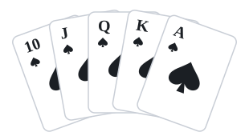

<h1 align="center">♠️ ♥️ Poker Hand Evaluator ♦️ ♣️</h1>

<p align="center">
  
</p>


A Rust library for evaluating poker hands, plus a small HTTP server ([axum](https://github.com/tokio-rs/axum)) that sits in front of it, packaged as a Docker image.

You give it the players' cards, the board and the rest of the deck. It validates the hand, works out each player's best hand, and returns the winner(s) with a readable description such as `"Full House, Sixes full of Fours"`.

## Contents
- [Supported variants](#supported-variants)
- [Quick start](#quick-start)
- [HTTP API](#http-api)
- [Library](#library)
- [How it works](#how-it-works)
- [Development](#development)
- [Roadmap](#roadmap)

## Supported variants

| Variant | `Variant` enum | API `variant` value | Player cards | Board |
| --- | --- | --- | --- | --- |
| Five-card draw | `FiveCardDraw` | `five-card-draw` | 5 | none |
| Texas Hold 'em | `TexasHoldem` | `texas-hold-em` | 2 | 5 |
| Omaha Hold 'em (four-card, hi) | `FourCardOmahaHi` | `four-card-omaha-hi` | 4 | 5 |

## Quick start

**Run locally:**
```sh
cargo run --bin server
# listening on 0.0.0.0:8080
```

**Or with Docker:**
```sh
docker build --pull --no-cache -t poker_hand_evaluator .
docker run --rm -p 8080:8080 --name poker_hand_evaluator poker_hand_evaluator
docker stop poker_hand_evaluator
```

## HTTP API

### `GET /variants`
Lists the supported variants with their display names.

```sh
curl localhost:8080/variants
```

```json
[
  {
    "http_request": "POST /evaluate (body.variant=five-card-draw)",
    "display": { "default": "Five-card draw", "alternates": ["Cantredraw"] }
  },
  {
    "http_request": "POST /evaluate (body.variant=texas-hold-em)",
    "display": {
      "default": "Texas Hold 'em",
      "alternates": ["Texas holdem", "hold 'em", "holdem"]
    }
  },
  {
    "http_request": "POST /evaluate (body.variant=four-card-omaha-hi)",
    "display": {
      "default": "Omaha Hold 'em",
      "alternates": ["Omaha holdem", "Omaha", "Four Card Omaha"]
    }
  }
]
```

### `POST /evaluate`
Evaluates a hand.

**Request body**

| Field | Type | Required | Notes |
| --- | --- | --- | --- |
| `id` | string | ✅ | Echoed back in the response |
| `variant` | string | ✅ | See [supported variants](#supported-variants) |
| `players` | `[{ id, cards }]` | ✅ | Player IDs must be unique |
| `board` | card[] | | Community cards (Hold 'em / Omaha) |
| `burn_cards` | card[] | | |
| `discarded_cards` | card[] | | Draw variants |
| `remaining_deck` | card[] | ✅ | Every card not used elsewhere |

**Card format:** a rank (`A K Q J T 9 8 7 6 5 4 3 2`) followed by a suit (`h d c s`), e.g. `Ah`, `Td`, `7c`.

The cards across all fields have to make up exactly one full deck with no repeats. The number of cards per player, on the board and so on is checked against the variant.

**Example: Texas Hold 'em**
```sh
curl -X POST localhost:8080/evaluate \
  -H "Content-Type: application/json" \
  -d '{
    "id": "hand-id",
    "variant": "texas-hold-em",
    "players": [
      { "id": "player-1-id", "cards": ["Ac", "Kc"] },
      { "id": "player-2-id", "cards": ["Jd", "Td"] }
    ],
    "board": ["Qc", "Jc", "Tc", "Qd", "7c"],
    "burn_cards": ["4h", "3h", "2h"],
    "remaining_deck": [
      "Ad","Kd","9c","8c","6c","5c","4c","3c","2c",
      "9d","8d","7d","6d","5d","4d","3d","2d",
      "As","Ks","Qs","Js","Ts","9s","8s","7s","6s","5s","4s","3s","2s",
      "Ah","Kh","Qh","Jh","Th","9h","8h","7h","6h","5h"
    ]
  }'
```
```json
{
  "id": "hand-id",
  "players": [
    { "id": "player-1-id", "hand": "Royal Flush" },
    { "id": "player-2-id", "hand": "Two Pair, Queens and Jacks" }
  ],
  "winners": ["player-1-id"],
  "winning_hand": "Royal Flush"
}
```

If players tie, `winners` contains more than one ID.

**Errors:** a malformed card, an unknown variant or a failed validation returns `400 Bad Request` with a plain-text message (e.g. `Unrecognised suit: tb`).

### Hand descriptions

| Hand | Example description |
| --- | --- |
| Royal flush | `Royal Flush` |
| Straight flush | `Six High Straight Flush`, `Wheel Flush` |
| Four of a kind | `Four of a Kind Sixes` |
| Full house | `Full House, Sixes full of Fours` |
| Flush | `Ace High Flush` |
| Straight | `King High Straight`, `Broadway`, `Wheel` |
| Three of a kind | `Three of a Kind Nines` |
| Two pair | `Two Pair, Tens and Nines` |
| Pair | `Pair of Tens` |
| High card | `High Card Ace` |

## Library

The crate exposes one entry point:

```rust
pub fn evaluate_hand(hand: Hand) -> Result<Evaluation, Error>
```

```rust
// Input
pub struct Hand {
    pub id: String,
    pub variant: Variant,
    pub players: Vec<Player>,
    pub board: Option<Vec<Card>>,
    pub burn_cards: Option<Vec<Card>>,
    pub discarded_cards: Option<Vec<Card>>,
    pub remaining_deck: Vec<Card>,
}

pub enum Variant {
    FiveCardDraw,
    TexasHoldem,
    FourCardOmahaHi,
}

// Output
pub struct Evaluation {
    pub id: String,
    pub players: Vec<PlayerEval>,
    pub winners: Vec<String>,
    pub winning_hand: String,
}

pub struct PlayerEval {
    pub id: String,
    pub hand: String,
}

// Error
pub struct Error {
    pub id: String,
    pub error_type: ErrorType,
    pub message: String,
}

pub enum ErrorType {
    Validation,
}
```

## How it works

The core evaluation logic is based on [Building a Poker Hand Evaluator Without Conditional Branches](https://javascript.plainenglish.io/building-a-poker-hand-evaluator-without-conditional-branches-556c39c8e33e). Encoding card ranks as a bitmask vastly simplifies the logic.

- **Five-card draw:** evaluates the five cards directly.
- **Texas Hold 'em:** picks the best five out of the seven cards available (2 hole cards + 5 board cards).
- **Omaha:** picks the best hand using **exactly two** hole cards and **exactly three** board cards.

## Development

Requires [`cargo-nextest`](https://nexte.st), plus [`cargo-audit`](https://crates.io/crates/cargo-audit) and [`cargo-outdated`](https://crates.io/crates/cargo-outdated) for the housekeeping targets.

| Command | Does |
| --- | --- |
| `make test` | Library + server tests |
| `make test-lib` | Library tests only |
| `make test-server` | Server tests only |
| `make audit` | Vulnerability checks |
| `make outdate` | Lists outdated dependencies |

Tests run on every PR via GitHub Actions. See [CHANGELOG.md](CHANGELOG.md) for release history.

## Roadmap
- [ ] More variants: 5-card and 6-card Omaha hi
- [ ] Better logging in the server
- [ ] Handle the few *touch wood* unreachable `unwrap`s / `unreachable!`s, just in case
- [ ] Set the port from an environment variable
- [ ] `cargo audit` pipeline (on PRs plus a scheduled cron)
